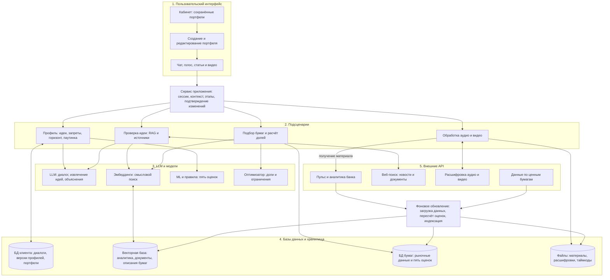

# Портфель с агентом

ИИ-помощник для создания и сопровождения инвестиционных портфелей. Превращает
пожелания пользователя в профиль и ограничения, подбирает бумаги и помогает
обсуждать изменения портфеля с учётом новостей и чужих идей.

## Тестовая версия

Доступно работающее демо: **[открыть приложение](https://tinvest-5-42-102-150.sslip.io/account)**.

- **Логин:** `demo`
- **Пароль:** `demo`

## Что реализовано

- Несколько портфелей со своими целями, ограничениями и историей.
- Подбор из 99 бумаг, анализ состава и рисков.
- Чат с агентом, добавление новостей и чужих идей.
- Виртуальное управление агентом с подтверждением сделок и журналом решений.
- Каталог портфелей сообщества, копирование и публикация стратегий.

[Подробное описание и локальный запуск](docs/application-guide.md).

## Архитектура будущей версии

